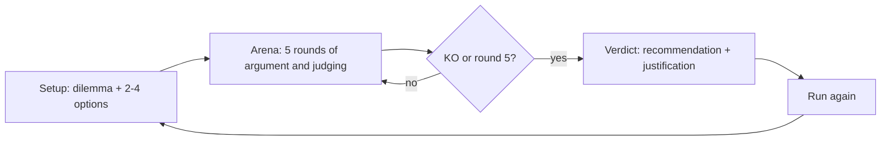
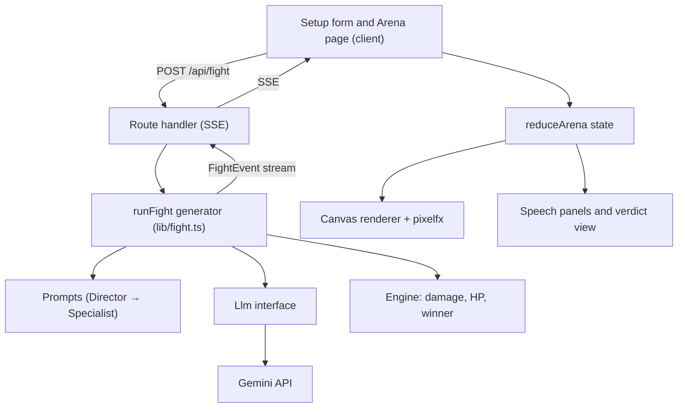
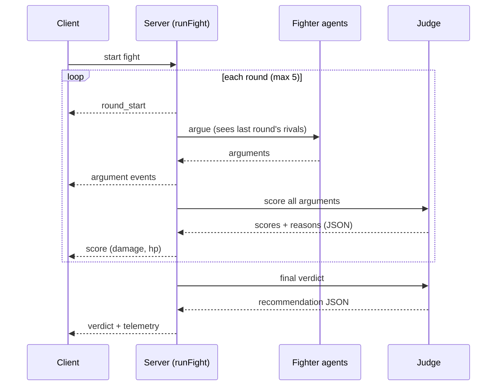
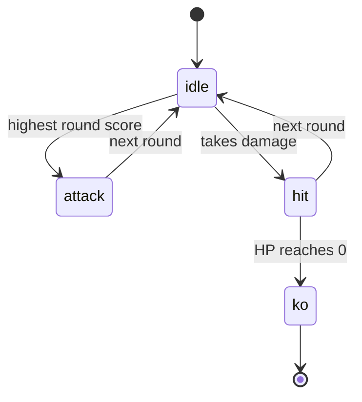
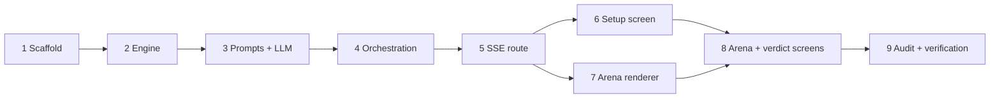

# Dilemma Arena: Architecture and Flow

See the [design](superpowers/specs/2026-11-07-dilemma-arena-design.md) and the [implementation plan](superpowers/plans/2026-11-07-dilemma-arena.md).

## 1. User journey

## 2. System components

## 3. One round

## 4. Fighter state

## 5. Damage rule
Round total per fighter = logic + evidence + honesty (0-30). Damage to a fighter = `max(0, highest total among the others − own total)`. HP starts at 100.

## 6. Task order

